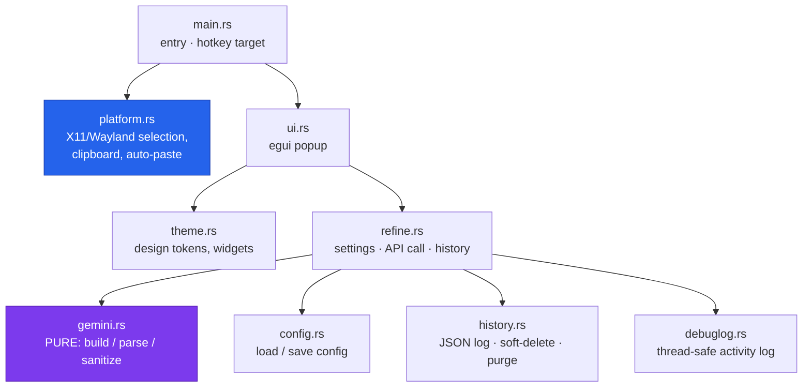

<div align="center">


# RefineAI for Linux

**Rewrite selected text with Gemini from a small floating popup — anywhere on the Linux desktop.**

[](./LICENSE)
[](https://www.rust-lang.org/)
[-informational.svg)](#install)
[](#install)

</div>

Highlight text in any app → press **Ctrl+Alt+R** → a popup appears with the rewrite. Edit it,
switch modes, retry, then **Replace** (copies back and pastes into the app) or **Copy**.

A single self-contained Rust binary (~7.7 MB) built on [egui](https://github.com/emilk/egui).
Talks straight to the Gemini API with your own key — no backend, no telemetry.

## Features

- 🪄 **Rewrite anywhere** — any app with text selection: editors, browsers, chat, terminals.
- ⌨️ **One hotkey** — the installer binds `Ctrl+Alt+R` for you; rebind it any time.
- 🎚️ **Modes** — Coherent, Formal, Concise, Fix grammar — editable in the config.
- ✏️ **Editable preview** — tweak the result, switch modes, or **Retry** before you commit.
- 📋 **Clipboard-first** — the result always lands on your clipboard; auto-paste is a best-effort extra.
- 🕘 **History + recycle bin** — every rewrite is logged locally, with a 30-day recycle bin.
- 🔐 **Your key, your data** — talks directly to Gemini; nothing else sees your text.
- 📦 **One static binary** — ~7.7 MB, no Python/Node/WebKit runtime.

## Install

One line — downloads the latest prebuilt binary (no Rust toolchain needed), adds an app
icon + menu entry, and binds the **Ctrl+Alt+R** shortcut on GNOME/Ubuntu:

```bash
curl -fsSL https://raw.githubusercontent.com/anurag-verma-india/refineai-linux/main/scripts/install.sh | bash
```

Everything lands under `~/.local` — no root required. You also need a clipboard helper
for your session:

```bash
sudo apt install wl-clipboard   # Wayland (Ubuntu default)
# sudo apt install xclip        # ...or this on an X11 session
# sudo apt install ydotool      # optional: enables auto-paste on Wayland
```

Then add your Gemini API key with `refineai --settings` (free key from
[Google AI Studio](https://aistudio.google.com/apikey)), and you're set.

**Uninstall** any time — removes the binary, icon, menu entry and shortcut; leaves your
config and history:

```bash
curl -fsSL https://raw.githubusercontent.com/anurag-verma-india/refineai-linux/main/scripts/install.sh | bash -s -- --uninstall
```

> **Not on GNOME?** The installer can't auto-bind the shortcut on KDE / Sway / Hyprland —
> bind the command `refineai` to a hotkey in your desktop's settings. On KDE:
> *System Settings → Shortcuts → Custom Shortcuts*. On Sway/Hyprland: a `bindsym`/`bind`
> line that runs `refineai`.

## Build from source and install

Needs the Rust toolchain and the GUI build deps:

```bash
curl --proto '=https' --tlsv1.2 -sSf https://sh.rustup.rs | sh   # if you don't have Rust
sudo apt install build-essential libgl1-mesa-dev

git clone https://github.com/anurag-verma-india/refineai-linux.git
cd refineai-linux
scripts/build-install.sh        # builds, installs, binds the hotkey
```

`scripts/build-install.sh --uninstall` removes it; `--no-shortcut` skips the hotkey;
`--no-build` installs an already-built `target/release` binary. By hand:
`cargo build --release && install -Dm755 target/release/refineai ~/.local/bin/refineai`.

## Architecture

The platform-specific glue is isolated behind one module, and the Gemini protocol is a
**pure** unit-tested core (build → parse → sanitize) with no platform types — so it ports
cleanly and tests without a network or a display server.



Full module map and the popup state machine: **[docs/ARCHITECTURE.md](./docs/ARCHITECTURE.md)**.

## Config

**Command-line flags:**

| Command | What it does |
| --- | --- |
| `refineai` | Read the current selection and open the refine popup (the hotkey target). |
| `refineai --settings` | Open the settings window (API key, model, toggles). |
| `refineai --help` | Usage. |

**Common settings** (in **⚙ Settings**): Gemini **model** (default `gemini-3.5-flash-lite`),
**low latency**, **direct replace**, **save history**, **debug mode**. **Modes** are edited
directly in the config JSON.

**File locations:**

| What | Where |
| --- | --- |
| Config — key, model, modes, toggles | `~/.config/refineai/config.json` (`0600`) |
| History log | `~/.local/share/refineai/history.json` |
| Binary · icon · menu entry | `~/.local/bin/` · `~/.local/share/icons/` · `~/.local/share/applications/` |

Everything — every setting, mode, model, history, auto-paste and privacy — is documented
in **[docs/CONFIGURATION.md](./docs/CONFIGURATION.md)**.

## Documentation

- **[Configuration & data](./docs/CONFIGURATION.md)** — all settings, modes, models, history, auto-paste, privacy.
- **[Architecture](./docs/ARCHITECTURE.md)** — module map and the popup state machine.
- **[Releasing](./docs/RELEASING.md)** — build and publish a release (maintainers).
- **[PLAN.md](./docs/PLAN.md)** — the design doc: why this shape, options weighed.

## License

Released under the [MIT License](./LICENSE). © 2026 Anurag Verma.
