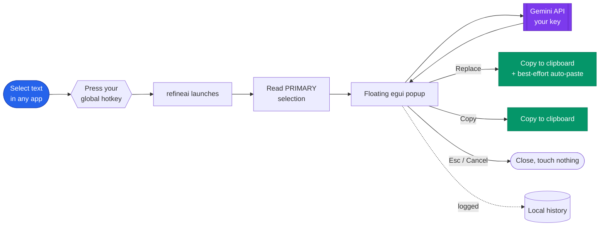

<div align="center">


# RefineAI for Linux

**Rewrite selected text with Gemini from a small floating popup — anywhere on the Linux desktop.**

[](#license)
[](https://www.rust-lang.org/)
[-informational.svg)](#requirements)
[](#)

</div>

Highlight text in any app → press your hotkey → a popup appears with the rewrite. Edit it,
switch modes, retry, then **Replace** (copies it back, pastes into the app) or **Copy**.

A single self-contained Rust binary (~7.7 MB), built on [egui](https://github.com/emilk/egui).
Talks straight to the Gemini API with your own key — no backend, no telemetry.

> [!NOTE]
> **How this differs from the Android app.** Android has `ACTION_PROCESS_TEXT`, which lets
> an app add an entry to the system text-selection toolbar and replace the selection in
> place. **Linux has no equivalent.** So RefineAI here is triggered by a **global keyboard
> shortcut** you bind yourself, and the result is placed on the **clipboard** (then
> auto-pasted on a best-effort basis). See [`PLAN.md`](./PLAN.md) for the full reasoning.

## How it works



## Features

- 🪄 **Rewrite anywhere** — any app with text selection: editors, browsers, chat, terminals.
- ⌨️ **One hotkey** — bind `refineai` to any shortcut; works on X11 and Wayland alike.
- 🎚️ **Modes** — Coherent, Formal, Concise, Fix grammar — editable in the config.
- ✏️ **Editable preview** — tweak the result, switch modes, or **Retry** before you commit.
- 📋 **Clipboard-first** — the result always lands on your clipboard; auto-paste is a best-effort extra.
- 🕘 **History + recycle bin** — every rewrite is logged locally, with a 30-day recycle bin.
- 🔐 **Your key, your data** — talks directly to Gemini; nothing else sees your text.
- 📦 **One static binary** — ~7.7 MB, no Python/Node/WebKit runtime.

## Requirements

- A **Gemini API key** — free from [Google AI Studio](https://aistudio.google.com/apikey).
- A clipboard helper for your display server:
  - **Wayland** (Ubuntu's default): `wl-clipboard`
  - **X11**: `xclip`
- *(Optional)* an input tool for auto-paste: `ydotool` (Wayland) or `xdotool` (X11).

Not sure which session you're on? Run `echo $XDG_SESSION_TYPE` (`wayland` or `x11`).

## Install

### Quick install (recommended)

One line — downloads the latest prebuilt binary, no Rust toolchain needed:

```bash
curl -fsSL https://raw.githubusercontent.com/anurag-verma-india/refineai-linux/main/scripts/install.sh | bash
```

This drops `refineai` on your `PATH` (under `~/.local/bin`) and adds an app icon + menu
entry — no root required. The installer lives at
[`scripts/install.sh`](./scripts/install.sh) — read it before piping to your shell if
you'd rather, or download and run it manually:

```bash
curl -fsSLO https://raw.githubusercontent.com/anurag-verma-india/refineai-linux/main/scripts/install.sh
bash install.sh                    # or: bash install.sh --version v0.1.0
```

First install the clipboard helper for your session:

```bash
sudo apt install wl-clipboard          # Wayland (Ubuntu default)
# sudo apt install xclip               # ...or this on an X11 session
# sudo apt install ydotool             # optional: enables auto-paste on Wayland
```

Uninstall any time:

```bash
curl -fsSL https://raw.githubusercontent.com/anurag-verma-india/refineai-linux/main/scripts/install.sh | bash -s -- --uninstall
```

### Build from source

You need the Rust toolchain and the build deps:

```bash
curl --proto '=https' --tlsv1.2 -sSf https://sh.rustup.rs | sh   # if you don't have Rust
sudo apt install build-essential libgl1-mesa-dev

git clone https://github.com/anurag-verma-india/refineai-linux.git
cd refineai-linux
./install.sh        # builds + installs; ./install.sh --uninstall to remove
```

Or by hand: `cargo build --release && install -Dm755 target/release/refineai ~/.local/bin/refineai`.

### Set up

**1. Add your API key** — `refineai --settings` (or launch *RefineAI* from your app menu).
Paste your Gemini key, pick a model if you like, and hit **Save**.

**2. Bind a global shortcut.** (GNOME / Ubuntu)

*Settings → Keyboard → View and Customize Shortcuts → Custom Shortcuts → `+`*

| Field | Value |
| --- | --- |
| Name | RefineAI |
| Command | `refineai` |
| Shortcut | e.g. `Ctrl+Alt+R` |

On KDE: *System Settings → Shortcuts → Custom Shortcuts*. On Sway/Hyprland: add a
`bindsym`/`bind` line that runs `refineai`.

## Usage

1. Select text in any app.
2. Press your shortcut.
3. In the popup: edit the result, switch mode (Coherent / Formal / Concise / Fix grammar),
   **Retry**, open **🕘 History**, or open **⚙ Settings**.
4. **Replace** puts the text on the clipboard and tries to paste it into your app;
   **Copy** just copies it. `Esc` or **Cancel** closes without touching anything.

## Configuration

The common toggles, editable in **⚙ Settings** (`refineai --settings`):

| Setting | What it does |
| --- | --- |
| **Model** | Gemini model id. Defaults to `gemini-3.5-flash-lite` (fast, free tier). |
| **Low latency** | Sends `thinkingLevel: "minimal"` on Gemini 3 models. |
| **Direct replace** | Skip the preview — copy as soon as the rewrite arrives. |
| **Save history** | Log every rewrite (soft-deletes swept after 30 days). |
| **Debug mode** | Show a live, timestamped activity log inside the popup. |

| What | Where |
| --- | --- |
| Config (key, model, modes, toggles) | `~/.config/refineai/config.json` (`0600`) |
| History log | `~/.local/share/refineai/history.json` |

**Modes**, model choices, auto-paste, and privacy details are covered in full in
**[docs/CONFIGURATION.md](./docs/CONFIGURATION.md)**.

## Documentation

- **[Configuration & data](./docs/CONFIGURATION.md)** — all settings, modes, models, history, auto-paste, privacy.
- **[Architecture](./docs/ARCHITECTURE.md)** — module map and the popup state machine.
- **[Releasing](./docs/RELEASING.md)** — build and publish a release on GitHub.
- **[Packaging for APT](./docs/PACKAGING-APT.md)** — ship to Ubuntu/Debian via `.deb`, PPA, or your own repo.
- **[PLAN.md](./PLAN.md)** — the design doc: why this shape, options weighed.

## Contributing

Contributions are welcome!

```bash
git clone https://github.com/anurag-verma-india/refineai-linux.git
cd refineai-linux
cargo build
cargo test        # the gemini core is fully unit-tested
```

A few pointers:

- Keep `gemini.rs` **pure** — no platform or network types — so it stays unit-testable.
- Put anything X11/Wayland-specific behind `platform.rs`.
- Run `cargo fmt` and `cargo clippy` before opening a PR.
- Found a bug or have an idea? Please
  [open an issue](https://github.com/anurag-verma-india/refineai-linux/issues).

## Releasing (maintainers)

Releases publish a prebuilt binary to GitHub so users get it from the one-line installer
above. [`release.sh`](./release.sh) does the whole flow — bump the version, build, test,
tag, push, and publish — taking the details as arguments (needs `cargo`, `git`, and an
authenticated [GitHub CLI](https://cli.github.com/)):

```bash
./release.sh 0.1.0                                   # version only
./release.sh 0.1.0 --notes "First release" --aarch64 # title/notes/arch, etc.
./release.sh --help                                  # all options
```

The flow — and the manual steps if you'd rather not use `gh` — is documented in
**[docs/RELEASING.md](./docs/RELEASING.md)**. To ship through `apt`, see
**[docs/PACKAGING-APT.md](./docs/PACKAGING-APT.md)**.

## License

Released under the [MIT License](./LICENSE). © 2026 Anurag Verma.
