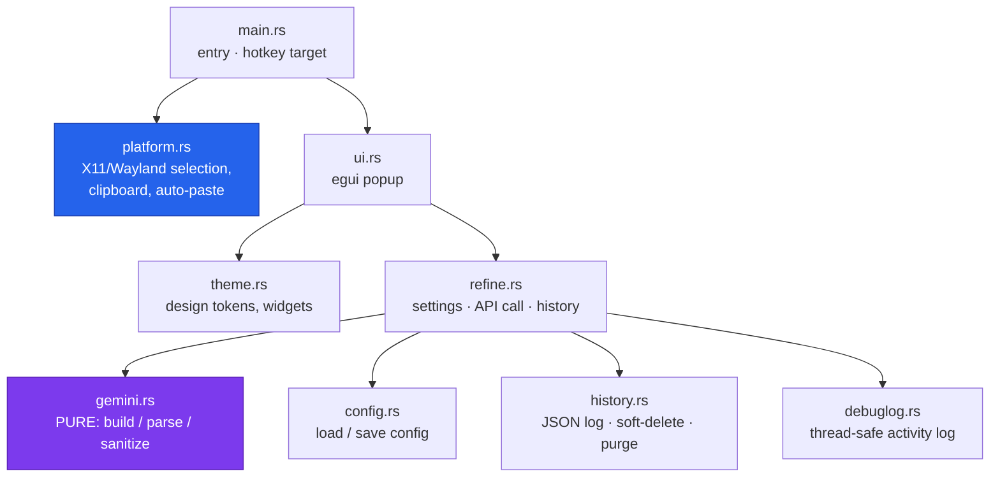

# Architecture

The platform-specific glue is isolated behind one module, and the Gemini
protocol is a **pure** unit-tested core (request build → parse → sanitize) with
no platform types — so it ports cleanly and tests without a network or a display
server.



```
refineai-linux/
├── Cargo.toml
├── README.md
├── scripts/
│   ├── install.sh       # one-line installer: downloads a prebuilt release + binds the hotkey
│   ├── build-install.sh # build from source + install + bind the hotkey
│   └── release.sh       # cut + publish a GitHub Release (for maintainers)
├── assets/refineai.svg # app icon
├── docs/               # architecture, configuration, releasing, design (PLAN.md)
└── src/
    ├── main.rs          # entry: read selection → popup
    ├── gemini.rs        # PURE request build + parse + sanitize (unit-tested)
    ├── refine.rs        # settings + API call + history, shared
    ├── platform.rs      # X11/Wayland: read selection, clipboard, auto-paste
    ├── history.rs       # JSON log, soft-delete, restore, 30-day purge
    ├── config.rs        # config load/save
    ├── debuglog.rs      # thread-safe activity log for debug mode
    ├── theme.rs         # design tokens + reusable gradient widgets
    └── ui.rs            # the egui popup
```

## The popup state machine

`ui.rs` is one eframe window driving a small state machine: **Loading →
Editing** (the editable preview) or **Error**, plus **Settings**, **History**,
and a **NeedKey** prompt shown when no API key is configured. The refine runs on
a background thread; results arrive over a channel and the UI polls each frame so
the popup never gets stuck on "Refining…".

## Design notes

See [`PLAN.md`](./PLAN.md) for the full reasoning behind this shape — in
particular why Linux uses a global hotkey + clipboard rather than the in-place
text replacement the Android app gets from `ACTION_PROCESS_TEXT`.
